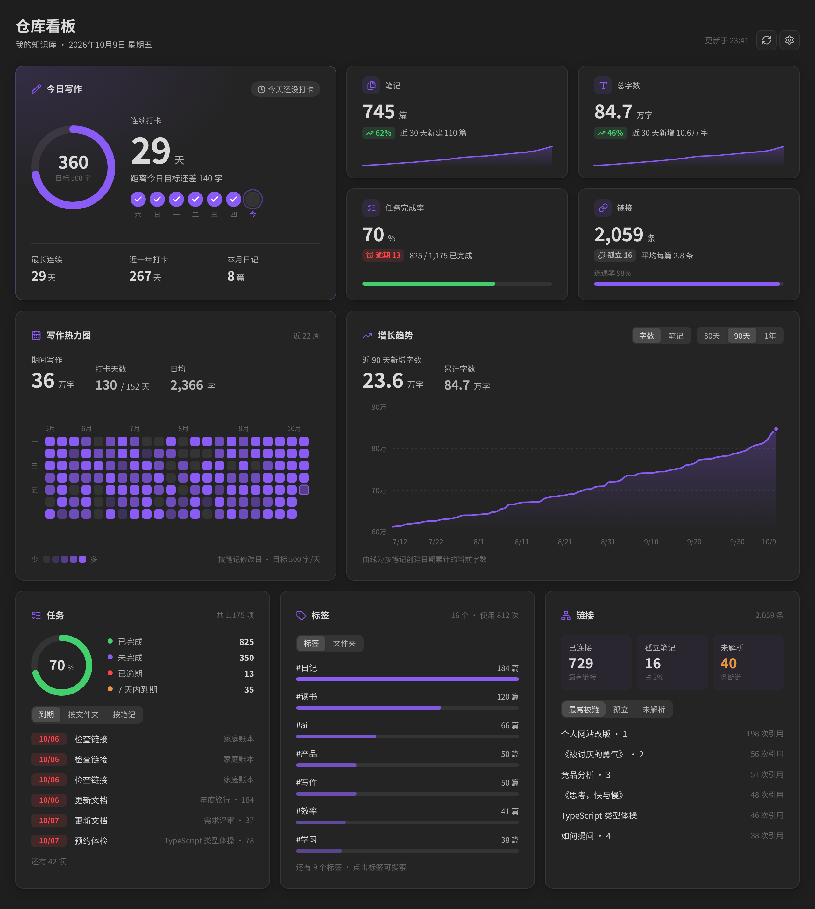
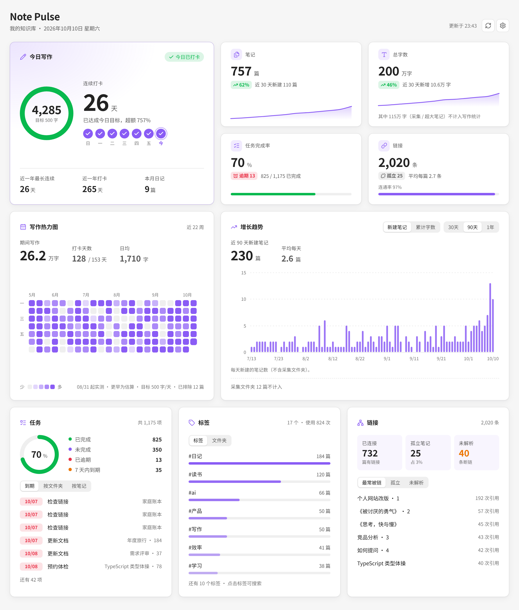
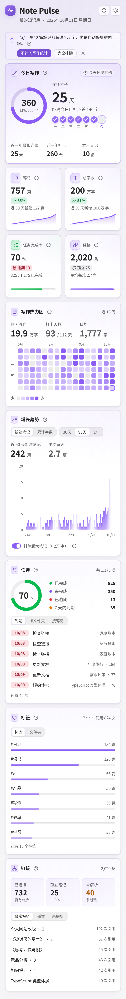
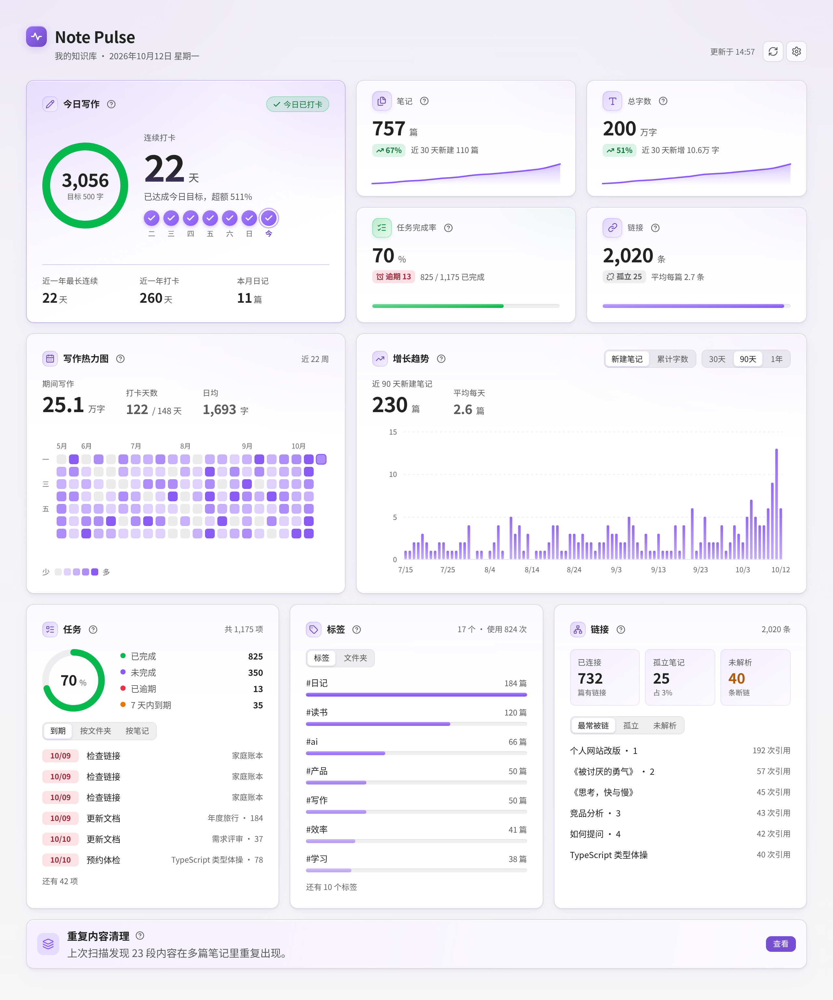
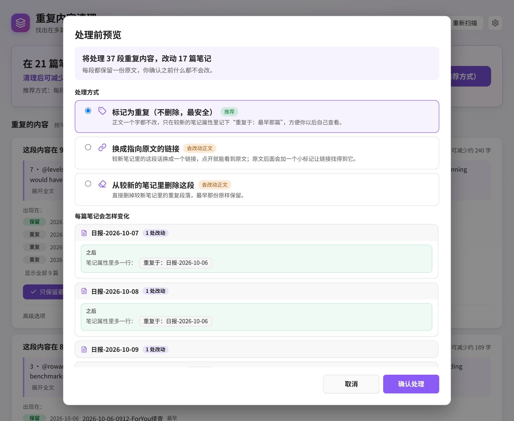
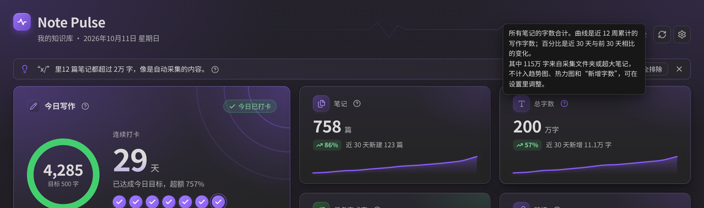

# Note Pulse

**English** | [中文](#中文说明)

Note Pulse is an [Obsidian](https://obsidian.md) plugin that opens a dashboard of your vault in one view: today's writing and streak, note and word count trends, a writing heatmap, task completion, and tag, folder and link stats.

The UI is in English and Chinese and follows Obsidian's language (you can pick one in settings). It follows your light or dark theme, has no external dependencies (all charts are plain SVG), and works on desktop and mobile.



<details>
<summary>Light theme and narrow layout</summary>





</details>

> Screenshots are rendered with sample data.

## Features

| Panel | What it shows |
| --- | --- |
| Headline | One sentence at the top: words written this week compared with the same days last week, your streak, today's goal and tasks due today |
| Today's writing | Progress ring for today's words vs. your daily goal, current and longest streak, this week as dots or bars (switch on the card), weekly goal progress, and the notes you touched today |
| Up next | Overdue tasks listed separately, then tasks due in the next 7 days; click to jump to the line. Understands `📅 YYYY-MM-DD`, `⏳` and `[due:: ]`; `- [-]` counts as cancelled |
| Stat cards | Total notes, total words, task completion rate and this month's check-in days. Hover a sparkline (or focus it and use the arrow keys) to read any of the last 12 weeks |
| Writing heatmap | Up to a full year, sized to the view width; hover for words written and notes changed or created; click a day to list notes modified that day. Keyboard: focus it, then use the arrow keys and Enter |
| Weekly writing | Words written (or new notes) per day over 30 days, or per week over six months or a year, with total, average and best period |
| Tags and folders | Most used tags with how many of this week's new notes use them (click to search), note and word counts per top-level folder (click to reveal) |
| Vault check-up | Updated with the dashboard: broken links (create the note in one click), orphan notes, repeated passages from the last duplicate scan, empty notes and oversized notes. Anything that changes a note asks first; deleted notes go to the trash |
| Writing reports (new in 1.5.0) | Weekly and monthly Markdown reports, preview before saving, previous-period comparisons, optional links to changed notes, and overwrite or save-as-new choices |
| Duplicate cleanup (new in 1.4.0) | A separate tab that finds passages repeated across notes (re-saved clippings, daily captures, AI reports) and helps you keep one copy. Its results also show up in the vault check-up |

Every note in the dashboard is clickable (mouse or keyboard). The dashboard refreshes automatically (debounced) when your vault changes, and only computes while it is visible. Word counts are cached on disk, so a restart only re-reads notes that changed. Tags, links and tasks come from Obsidian's metadata cache; word counts are cached by modification time, so later refreshes only re-read changed files.

## Installation

### From Community plugins

1. Open **Settings → Community plugins → Browse**.
2. Search for **Note Pulse**, then install and enable it.

### Manual

1. Download `main.js`, `manifest.json` and `styles.css` from the [latest release](https://github.com/FengBuL/note-pulse/releases/latest).
2. Put them in `<your vault>/.obsidian/plugins/note-pulse/`.
3. Reload Obsidian and enable **Note Pulse** under **Settings → Community plugins**.

### Usage

Click the dashboard icon in the left ribbon, or run the command **打开看板** (Open dashboard) from the command palette. Use **刷新看板数据** (Refresh dashboard) to recompute.

### Writing goals and reports (1.5.0)

Set **每周字数目标** (Weekly word goal) to your target; the default is 1500, and 0 turns off the goal. Today's writing shows progress for Monday through Sunday and check-ins out of seven days. Existing settings are preserved during the upgrade.

Run **生成写作周报** (Generate writing weekly report) or **生成写作月报** (Generate writing monthly report), or use the **写作回顾** card. Choose the current or previous calendar period, optionally include links to modified notes, then review the Markdown preview and save. Reports go to **Note Pulse** by default; change **写作报告保存位置** (Report folder) in settings, or leave it empty for the vault root. Existing files are only overwritten after you choose **覆盖现有笔记**; **另存为新文件** adds a numeric suffix.

Reports include words written, check-in days, new notes, the longest note, common tags, and changes from the previous period. Words and check-ins use the dashboard's writing mode and exclusions. New-note counts follow the dashboard too: collected notes are excluded; oversized notes still count as notes. Rankings, tags and optional note lists exclude collected notes and oversized notes when that exclusion is enabled. Rankings use current note content; note lists use each file's latest modification time, so they cannot reconstruct every historical edit. Current periods are compared with the complete previous period, and reports state when writing counts are estimated or unavailable before recording began.

## Settings

| Setting | Description |
| --- | --- |
| Excluded folders | Notes in these folders are ignored completely, one per line or comma separated |
| Collection / clipping folders | Folders for web clippings or automated dumps. Their notes still count as notes, but not toward word trends, the heatmap, streaks or the "new notes" curve |
| Exclude oversized notes (threshold) | Notes longer than this (default 20,000 words) do not count toward writing stats. The dashboard says what was excluded and has a one-click switch |
| Daily notes folder | Notes named `YYYY-MM-DD` here count as daily notes; leave empty to search the whole vault |
| Daily word goal | A day counts toward your streak when it reaches this many words (or has a daily note); 0 means any writing counts |
| Heatmap mode | **Smart** (default): days since you enabled the plugin use real daily added words, recorded even while the dashboard is closed; earlier days are estimated from modified dates. **By modified date**: a note's full word count goes to the day it was last modified (rough). **By daily added words**: measured data only |
| Created date fields | Frontmatter fields such as `created: 2025-01-01` used as the creation date, useful when sync resets file times |
| Auto refresh and delay | Refresh after vault changes, and the debounce delay |
| Open notes in new tab | Keep the dashboard open when you click a note |
| Word count properties | Section **字数属性**: enable (off by default), property names, optional reading time and speeds, minimum change, idle time, skip oversized notes, include / exclude folders, batch update and remove buttons. See [Word count properties](#word-count-properties-for-bases) |

## Word count properties (for Bases)

Note Pulse can write each note's word count into its properties (frontmatter) as a **number**, so [Bases](https://help.obsidian.md/bases) can sort, filter and run formulas on it. This **edits your notes, so it is off by default**. Turn it on under **Settings → Note Pulse → 字数属性** (Word count properties).

```yaml
---
words: 1832
reading_time: 5
---
```

- **What is written:** `words` (the same CJK-aware count the dashboard uses: frontmatter, code, comments, URLs, embeds and Markdown syntax are not counted, each CJK character is one word, other languages count by words). Optionally `reading_time` in minutes, rounded up, from two speeds you can set (default 400 CJK characters/min and 220 words/min). Property names are configurable.
- **When:** only the note you are editing, only after you stop typing for a few seconds (default 5, minimum 3). Notes that were modified in the last 2 seconds (for example just changed by iCloud) are never touched; the plugin's own writes never trigger another write.
- **Never writes if nothing changed.** A note is rewritten only when the stored number is missing, not a number, or differs from the new count by at least the threshold (default 1; raise it to cut down on file changes and sync traffic). Empty notes without the property are left alone.
- **Scope:** `.md` files only. Skips the dashboard's excluded folders, an extra "do not write" folder list, and (optional, on by default) notes above the oversized-note threshold. You can also restrict it to a list of folders.
- **Commands:** **更新当前笔记字数属性** (update the current note), **批量更新所有笔记字数属性** (update all notes: shows a dry-run count and asks to confirm, then writes in batches with a progress notice) and **移除所有字数属性** (remove the properties from every note, with a confirmation). The commands also work while the automatic mode is off.

> **Heads-up.** Obsidian rewrites the whole properties block when a property is saved (that is how `processFrontMatter` works): comments inside the YAML can be lost and a note without properties gets a new block. Back up first, and try a small folder with "only write to these folders". "Remove" deletes any property with the configured name, including one you created yourself.

### Example: a Bases view of your longest notes

Save this as `Longest notes.base` (or paste it into a `base` code block). It uses only documented Bases syntax: a filter on `words`, a formula, display names, column order and a column summary.

```yaml
filters:
  and:
    - file.ext == "md"
    - words > 1000
formulas:
  read_min: "(words / 400).ceil()"
properties:
  words:
    displayName: Words
  formula.read_min:
    displayName: Minutes to read
views:
  - type: table
    name: Longest notes
    order:
      - file.name
      - words
      - formula.read_min
      - file.mtime
    summaries:
      words: Sum
```

Then open the base, open the **Sort** menu, choose **Add sort → words** and set it to descending (Obsidian saves the sort into the `.base` file for you). Run **批量更新所有笔记字数属性** once first so existing notes have the property. If you enable `reading_time`, use it directly as a column instead of the `read_min` formula. Filters and formulas reference the property as `words` (shorthand for `note.words`). See the [Bases syntax](https://help.obsidian.md/bases/syntax) page for more.

## Duplicate cleanup

New in 1.4.0. This used to be a separate plugin, Clip Dedupe. It is now built into Note Pulse because both are tools for keeping a vault tidy. If you installed Clip Dedupe, you can disable and remove it: Note Pulse picks up its settings the first time it loads (it only reads Clip Dedupe's files and never changes them). Undo history from the old plugin stays with the old plugin.

Open it from the **layers** icon in the ribbon, the command **打开重复内容清理**, or the card at the bottom of the dashboard.

1. **Scan.** Choose the whole vault or one folder. Scanning only reads notes and never changes them.
2. **See what repeats.** Every result says in plain words how many notes a passage appears in, which copy is the earliest, and how many characters a cleanup would save.
3. **Choose how to handle it.** Before anything changes you get a preview of every note. The default only marks later copies with a `duplicate_of` property and leaves the text alone. You can also replace later copies with a link to the original, or delete them. A backup is written first and **撤销上一次重复内容清理** undoes the last cleanup.

Advanced options (what counts as a passage, which copy to keep, link style, property name, backups to keep) are collapsed by default under 设置 → 重复内容清理 · 高级. The whole feature can be switched off in settings, which hides the ribbon icon, the commands and the dashboard card.






## Keeping the numbers honest

- **Oversized notes and clipping folders.** A single auto-collected file with 200,000 characters can outweigh a year of writing. Note Pulse excludes notes over the threshold from writing stats by default, lets you mark whole folders as "collection" folders, and suggests it in a banner when it finds a folder where most notes are oversized.
- **The word trend is based on current word counts.** It adds each note's current word count on its creation date. It is not a historical snapshot, so editing an old note changes the past. The chart says so, and "new notes per day" is the default view for that reason.
- **Vault checkup.** Broken links that can only mean one note (it was moved, or the name differs only in spaces or case) can be fixed in one click; you see which notes change first, and you can undo. Other broken links can create the missing note. Orphans can be skipped per folder (Settings → Scope), and clipping folders are skipped automatically. The checkup also lists notes that share a name (a bare [[link]] may point to the wrong one) and attachments no note uses.
- **Creation dates can be wrong after sync.** If many notes share one creation day, a banner points you to the created-date field setting.
- **Streaks** count a day when it reaches the daily goal, or you wrote a daily note with at least 10 words. An empty template does not count. The current streak is not broken by today until the day is over.
- **Several devices and outside writers.** Each device only records words typed in its own Obsidian editor, into its own log file, and the dashboard adds them up, so writing on both phone and computer is not double counted. Changes that arrive by sync, and text that AI assistants, scripts or import tools write straight into notes, update the note's word count but not "words added". Text typed in other editors does not count either.

## Notes and limits

- Word counts are approximate. Frontmatter, code blocks, comments, URLs, embeds and Markdown syntax are removed; each CJK character counts as one word, other languages are counted by words.
- Creation time defaults to the file's ctime, which sync tools (iCloud, Git, …) may reset. Add a `created` frontmatter field for accurate trends.
- The cumulative word trend assigns each note's current word count to its creation date. It is not a historical snapshot.
- "Added words" only counts increases: rewriting a paragraph to the same length adds nothing, and deleting text does not subtract.
- The "links" figure counts links between notes, not image or file embeds.
- Ribbon tooltips and command names switch language only after restarting Obsidian. Everyone, including people updating from an older version, starts on Follow Obsidian; pick a fixed language under Settings → Refresh and behavior → Language.
- Dates use your local time zone.
- Clicking a tag needs the core **Search** plugin enabled.
- The plugin reads your notes locally only. It makes no network requests and collects no data.

## Development

```bash
npm install
npm run dev     # watch build
npm run build   # type check + production build -> main.js
npm test        # unit tests for counting and the write decision, plus an in-memory simulation of the update flow
npm run check:css     # browser compatibility of styles.css
npm run check:tokens  # dashboard styles only use the design tokens (font sizes, radii, shadows, durations)
```

To look at the dashboard in a browser with sample data, without Obsidian:

```bash
node scripts/preview/build.mjs
open scripts/preview/index.html            # add ?theme=dark and/or &week=bars
```

The preview runs the real `src/view.ts` and `styles.css` with a small stand-in for Obsidian's DOM helpers; the numbers are sample data. Icons come from `scripts/preview/icons.json`, generated with `node scripts/preview/build-icons.mjs <lucide>/dist/esm/icons`. Design rules are in `docs/design/2026-10-22-质感规范.md`.

```
src/
├── main.ts      # entry: view, commands, ribbon icon, auto refresh, background word tracking, persistence
├── view.ts      # dashboard view and panels
├── dashboard-logic.ts # pure calculations for the dashboard: this week, headline, weekly series, check-up
├── stats.ts     # statistics (tasks, links, tags, folders, daily notes)
├── count.ts     # word counting (pure, CJK-aware)
├── wordprops.ts # word count properties: triggers, batch update, remove, confirm dialogs
├── wordprops-logic.ts # pure decisions: scope, reading time, write-or-not
├── charts.ts    # SVG charts: trend, sparkline, ring, bar list, tooltip
└── settings.ts  # settings tab
```

Settings and the daily word log live in `data.json`; the per-note word-count cache lives in `cache.json` next to it (safe to delete, it is rebuilt).

To release, run `npm version <patch|minor|major>` (updates `manifest.json` and `versions.json`), run `npm run build`, then create a GitHub release whose tag matches the version (no `v` prefix) and attach `main.js`, `manifest.json` and `styles.css`.

## Changelog

### 1.4.0

- Clip Dedupe is merged into Note Pulse as **Duplicate cleanup** (重复内容清理): its own tab, a ribbon icon, four commands, and a subtle entry card at the bottom of the dashboard.
- Keeps the beginner flow from Clip Dedupe 1.1.0: a welcome screen with three steps, plain wording, preview before every change, one-click undo, help, and advanced options collapsed.
- New settings group 重复内容清理 with an on/off switch and a switch for the dashboard card. Existing Note Pulse settings are untouched; settings from a standalone Clip Dedupe install are imported once.
- Its cache and backups live in the Note Pulse plugin folder (`dedupe-cache.json`, `dedupe-backups/`).

### 1.3.0

New: **write word counts into note properties**, so Bases can use them. Everything is opt-in; the dashboard is unchanged.

- New settings section **字数属性**: enable toggle (off by default), property name (`words`), optional reading time (`reading_time`, minutes, with configurable CJK and word speeds), minimum change before rewriting, idle time, skip oversized notes, include / exclude folder lists.
- Values are written as numbers with `processFrontMatter`, so Bases can sort, filter and use them in formulas.
- Automatic updates follow only the note you are editing, after you stop typing. A note is never rewritten when the value is unchanged, notes modified in the last 2 seconds are skipped, and the plugin ignores its own writes.
- New commands: **更新当前笔记字数属性**, **批量更新所有笔记字数属性** (dry-run count, confirmation, batches with progress) and **移除所有字数属性** (confirmation).
- README: how to use the property in a Bases view, with a `.base` example checked against the official Bases syntax docs.
- Word counting moved to its own module (`count.ts`), same behaviour; added unit tests (`npm test`).

### 1.2.4

Clean-up release for the Obsidian community plugin review. No visual change, apart from one tiny detail noted below.

- **Minimum Obsidian version is now 1.7.2** (was 1.4.0). The dashboard uses `Workspace.revealLeaf()`, which was added in 1.7.2.
- **No more `!important` in `styles.css`.** The few places that had to override Obsidian's default button, heading and padding styles now do it with more specific selectors instead. The hero ring size is passed to CSS as a variable. I compared computed styles and screenshots (light, dark, desktop, narrow, phone, tablet, reduced motion) against 1.2.3 and they match, including the phone bottom padding and no-jump behaviour from 1.2.3.
- **Browser-compatibility lint.** `column-gap` on grid layouts is written as `gap`; the "unresolved link" underline is a plain underline instead of a dotted one (the only visible change); the temporary `display: contents` wrapper used while redrawing a card is now set from code.
- **Type-safety and lint fixes.** The few private Obsidian internals (global search, file explorer, settings dialog) are accessed through small typed interfaces with no `any` and no lint-disable comments; promises are handled explicitly (`void`) in click handlers; `window.setTimeout` is used for popout windows; an `instanceof`/type-guard replaces a `TFile` cast; unnecessary regex escapes and type assertions removed; the cache file is parsed into a typed shape.
- **Settings are declared once** and rendered both by `getSettingDefinitions()` (Obsidian 1.13+, so settings show up in settings search) and by the classic `display()` for older versions. The reset button uses the same style class as before.
- **Build:** the `builtin-modules` dev dependency was replaced by Node's own `module.builtinModules`.

### 1.2.3

- **Mobile: the last card is no longer hidden behind the floating bottom bar.** The dashboard had its padding reset to zero, which also removed the room Obsidian leaves for the mobile navigation bar (back / forward / search / new / tabs / menu). On phones and tablets the scroll area now has bottom padding equal to the navbar height plus the safe area, so the "Links" card can be scrolled fully clear of it.
- **Mobile: tapping inside a card no longer makes the page jump.** Switching a tab in Tasks, Tags or Links only redraws that card, keeps the scroll position, and the card never gets shorter than it has been (a shorter tab used to shrink the page and push the view up when you were at the bottom). Full refreshes also keep the scroll position, focus no longer scrolls the page, tapping a list row no longer focuses it, and a tap that does not move your finger can no longer change the scroll position. Sticky "hover" shadows on touch screens are disabled.

### 1.2.2

- **Removed the decorative concentric arcs from the "today" card.** The faint rings in its top-right corner are gone, along with leftover header pulse-line styles. The progress ring, the card's soft gradient and the gradient logo badge are unchanged.

### 1.2.1

- **Removed the pulse line from the header.** The faint decorative line behind the title is gone; the gradient logo badge stays.
- **Softer glows.** The accent glows are now about half as strong in both light and dark: the corner glows on the page background, the hero card's rings and glow, the card and KPI tints, and the glow under the sparklines and trend line. Layout, colours and text contrast are unchanged.

### 1.2.0

- **A richer look, same layout.** The dashboard no longer sits on flat white/grey. The page now has a soft vertical wash with faint accent glows in the top corners; cards have a gentle tinted gradient, a 1px highlight along the top edge and layered shadows; the header gets a gradient logo badge and a faint pulse line.
- **Hero card.** The "today" card has a stronger accent gradient with decorative concentric rings, and the streak number is lightly shaded.
- **Icon chips and charts.** Card and KPI icons sit in gradient chips (the task-completion card uses green), sparklines and the trend line get a soft glow, trend bars fade from top to bottom, and progress bars have a subtle sheen.
- **Works with your theme.** Everything is derived from Obsidian's own colour variables and `color-mix()` on the theme's accent colour, so it follows light/dark themes and custom accent colours. It uses only CSS and inline SVG (no images), and falls back to flat colours where `color-mix()` isn't available.
- **Readability.** Secondary text, status badges (up/down, overdue, due soon) and the primary button were darkened slightly so text keeps at least WCAG AA contrast (4.5:1) on the new backgrounds in the default light and dark themes. Animations still respect "reduce motion".

### 1.1.2

- **Fix: hovering a "?" showed two tooltips.** Obsidian pops up its own tooltip for any element that has an `aria-label`, on top of Note Pulse's own bubble. Accessible names now live in visually hidden text (`aria-labelledby`), so only one tooltip appears. The same cleanup was applied to the heatmap, trend chart, KPI cards, ring, lists, and tab buttons; only the icon-only buttons (refresh, settings, close) keep Obsidian's own tooltip, as their single one.
- **Fix: the writing heatmap had lost its gradient.** Levels were tied to your daily goal, so if you usually write far more than the goal almost every day landed in the top two shades. Levels now come from percentiles of your own writing days (about 30% / 60% / 85%), so all four shades get used whatever your pace; with very little data it falls back to ratios of your daily goal. Colours were also redone: a clearer five-step ramp, and empty days are now a neutral grey so the lightest level no longer blends in.

### 1.1.1

- **Explanations moved into "?" icons.** The footnote lines under cards (for example "14.9万 words of collected / oversized notes are not counted" under Total words, the notes under the trend chart, and the heatmap mode line) are gone. Each card now has a small "?" next to its title; hover it or focus it with the keyboard (Tab) to read the explanation in a tooltip. The cards keep a uniform height and the charts are no longer pushed up.
- The switch that excludes oversized notes stays, with its details (counts, largest files) in its own "?".
- Welcome and suggestion banners are now a compact single row with a × to dismiss them for good.



### 1.1.0

- **Fix: auto-collected files distorted the trend.** Notes over a threshold (default 20,000 words) are excluded from word trends, the heatmap and streaks, with a visible note of what was excluded and a switch to include them. New "collection folders" setting; a banner suggests folders that look auto-collected, with one-click buttons.
- Growth trend now defaults to **new notes per day**; the cumulative word curve is labelled as based on current word counts.
- Heatmap default is now **Smart**: measured daily added words from the day you enabled the plugin (recorded in the background, even when the dashboard is closed), estimates before that. Estimates are marked in the tooltip.
- Daily notes with fewer than 10 words no longer count as a check-in. "Longest streak" is labelled as covering the past year.
- Word counting: counts Greek, Arabic, Hangul and other scripts by word (Hangul was counted per syllable); fixed possible slowdowns on huge pasted text.
- Word-count cache is stored on disk, so restarting Obsidian no longer re-reads every note. Saving no longer rewrites a large `data.json` on every refresh.
- Does not compute while the dashboard is hidden behind another tab; refreshes at midnight; "links" no longer counts image embeds.
- Accessibility: keyboard focus and Enter/Space for every clickable row, tab roles, arrow-key navigation in the heatmap, higher-contrast secondary text, chart descriptions. Switching a tab no longer rebuilds the whole dashboard or drops focus.
- Empty-vault and error states; first-run welcome banner; settings page grouped into sections.

### 1.0.0

First release.

## License

[MIT](LICENSE) © FengBuL

---

## 中文说明

Note Pulse（笔记脉搏）是一个 Obsidian 插件，在一个页面里集中展示你仓库的各项数据：今日写作与连续打卡、笔记与字数趋势、写作热力图、任务完成情况，以及标签、文件夹和链接统计。

界面有中文和英文，默认跟随 Obsidian 的界面语言，也可以在设置里指定；自动适配明暗主题，没有任何外部依赖（图表均为原生 SVG），桌面端和移动端都能用。

### 功能

| 区块 | 内容 |
| --- | --- |
| 页首一句话 | 本周写了多少、和上周同期比、连续写作天数、今天是否达标、今天到期的任务 |
| 今日写作 | 今日字数与每日目标的进度环、当前与最长连续打卡、本周七天（圆点或柱状，卡片上切换）、每周目标进度、今天动过的笔记 |
| 接下来 | 已逾期的任务单独列出，下面是 7 天内到期的；点击直接跳到任务所在行。识别 `📅 YYYY-MM-DD`、`⏳`、`[due:: ]`，`- [-]` 视为已取消 |
| 数据卡 | 笔记总数、总字数、任务完成率、本月打卡天数。鼠标停在走势线上（或聚焦后按左右方向键）可以逐周查看近 12 周的数值 |
| 写作热力图 | 按看板宽度最多显示一整年；悬停查看当天写作字数、修改和新建笔记数；点击格子查看当天修改过的笔记；聚焦后可用方向键和回车操作 |
| 每周写作 | 30 天按天、半年和一年按周显示写作字数（或新建笔记数），附合计、平均和最高的一段 |
| 标签 / 文件夹 | 标签使用排行，附本周新建笔记里用到它的篇数（点击搜索）；各顶层文件夹的笔记数和字数（点击在文件列表中定位） |
| 库体检 | 随看板一起刷新：断链（一键新建笔记）、孤立笔记、上次扫描发现的重复内容、空笔记和超大笔记。会改动笔记的操作都先确认，删除的笔记进回收站 |
| 写作回顾（1.5.0 新增） | 周报、月报，先预览再保存为笔记 |
| 重复内容清理（1.4.0 新增） | 独立标签页：找出在多篇笔记里重复出现的段落（反复剪藏的文章、每日采集、AI 报告），帮你只留一份。扫描结果也会显示在库体检里 |

看板中的笔记都可以点击（也支持键盘）打开。仓库内容变化后会自动刷新（带防抖，只在看板可见时计算）。字数缓存会保存在磁盘上，重启后只重新读取改动过的笔记。

### 安装

**插件市场：** 打开「设置 → 第三方插件 → 浏览」，搜索 **Note Pulse**，安装并启用。

**手动安装：**

1. 从 [最新 Release](https://github.com/FengBuL/note-pulse/releases/latest) 下载 `main.js`、`manifest.json`、`styles.css`。
2. 放进 `<你的仓库>/.obsidian/plugins/note-pulse/`（`.obsidian` 是隐藏文件夹，Mac 上按 `Cmd+Shift+.` 显示）。
3. 重启 Obsidian，在「设置 → 第三方插件」中启用 **Note Pulse**。

**使用：** 点左侧边栏的看板图标，或在命令面板运行「打开看板」。

### 设置项

| 设置 | 说明 |
| --- | --- |
| 排除的文件夹 | 其中的笔记完全不参与统计，每行一个或用逗号分隔 |
| 采集 / 剪藏文件夹 | 网页剪藏、自动抓取之类的文件夹。里面的笔记仍计入笔记总数，但不计入字数趋势、热力图、打卡和“新建笔记”曲线 |
| 排除超大笔记（阈值） | 超过该字数（默认 2 万）的笔记不计入写作统计；看板上会注明排除了哪些，并提供一键开关 |
| 日记文件夹 | 文件名为 `YYYY-MM-DD` 的笔记视为日记；留空则在整个仓库中识别 |
| 每日字数目标 | 当天字数达到目标即算打卡（写了日记也算）；设为 0 表示有写作就算 |
| 写作热力图统计方式 | **智能**（默认）：启用插件之后按每日实际新增字数记录（看板关着也记），之前按最后修改日估算；**按修改日**：笔记全文字数计入最后修改的那天（较粗略）；**按每日新增字数**：只用实测数据 |
| 创建日期字段名 | frontmatter 中的 `created: 2025-01-01` 等字段优先作为创建日期，适合同步后文件时间不准的情况 |
| 自动刷新 / 延迟 | 内容变化后自动刷新及防抖时间 |
| 在新标签页打开笔记 | 点击看板中的笔记时是否新开标签页 |
| 字数属性 | 「字数属性」分组：启用开关（默认关闭）、属性名、可选阅读时长和速度、最小变化字数、停手等待时间、不写入超大笔记、包含 / 排除文件夹，以及批量更新和移除按钮。详见下面的「字数写入笔记属性」 |

### 字数写入笔记属性（配合 Bases）

Note Pulse 可以把每篇笔记的字数以**数字**写进它的属性（frontmatter），这样 [Bases（基础）](https://help.obsidian.md/bases) 就能按字数排序、筛选和写公式。这会**修改你的笔记，所以默认关闭**。在「设置 → Note Pulse → 字数属性」里打开。

```yaml
---
words: 1832
reading_time: 5
---
```

- **写什么：** `words`（和看板同一套按中日文字计数的算法：不算 frontmatter、代码、注释、网址、嵌入和 Markdown 符号，每个汉字算一个字，其他语言按词）。可选再写 `reading_time`（分钟，向上取整），按你设置的两个阅读速度估算（默认中日文 400 字/分钟、其他文字 220 词/分钟）。属性名都可以改。
- **什么时候写：** 只跟随你正在编辑的那篇笔记，停止输入几秒后才写（默认 5 秒，最小 3 秒）。最近 2 秒内被修改过的笔记（比如刚被 iCloud 同步改动）不会碰；插件自己的写入不会再触发写入。
- **没变化绝不写：** 只有属性不存在、不是数字，或与新字数相差达到阈值（默认 1，调大可以减少文件改动和同步）时才写。没有属性的空笔记不会被加上属性。
- **范围：** 只处理 `.md` 文件；跳过看板里“排除的文件夹”、另外设置的“不写入这些文件夹”，以及（可选，默认开启）超过超大笔记阈值的笔记；也可以只写入指定的文件夹。
- **命令：** 「更新当前笔记字数属性」「批量更新所有笔记字数属性」（先显示试算数量并让你确认，再分批写入并显示进度）和「移除所有字数属性」（需确认）。自动模式关闭时这些命令也能用。

> **注意：** 保存属性时 Obsidian 会重写整个属性区（`processFrontMatter` 的行为）：YAML 里的注释可能丢失，没有属性的笔记会新增一个属性区。请先备份，也可以先用“只写入这些文件夹”在一个小文件夹里试。“移除”会删掉所有同名属性，包括你自己加的。

#### 示例：用 Bases 看最长的笔记

保存为 `Longest notes.base`（或粘贴进 `base` 代码块）。只用了官方文档里有的语法：按 `words` 过滤、一个公式、显示名、列顺序和列汇总。

```yaml
filters:
  and:
    - file.ext == "md"
    - words > 1000
formulas:
  read_min: "(words / 400).ceil()"
properties:
  words:
    displayName: 字数
  formula.read_min:
    displayName: 阅读分钟
views:
  - type: table
    name: 最长的笔记
    order:
      - file.name
      - words
      - formula.read_min
      - file.mtime
    summaries:
      words: Sum
```

然后打开这个 base，点「排序」菜单，选「添加排序 → words」并设为降序（Obsidian 会自动把排序存进 `.base` 文件）。先运行一次「批量更新所有笔记字数属性」，已有笔记才有这个属性。如果开启了 `reading_time`，可以直接把它当作一列，不需要 `read_min` 公式。过滤和公式里直接写 `words`（是 `note.words` 的简写）。更多语法见 [Bases 语法](https://help.obsidian.md/bases/syntax)。

### 重复内容清理

1.4.0 新增。它原本是一个单独的插件 Clip Dedupe，因为和看板一样都是管理笔记库的工具，现在直接并入 Note Pulse。如果你装过 Clip Dedupe，可以关闭并卸载它：Note Pulse 第一次加载时会沿用它的设置（只读取，不改动它的文件）。旧插件里的撤销记录仍留在旧插件中。

打开方式：侧边栏的“层叠”图标、命令“打开重复内容清理”，或看板底部的小卡片。

1. **扫描**：选整个笔记库或某个文件夹。扫描只读，不会改动任何笔记。
2. **查看哪些内容重复了**：每条结果都用大白话写清楚这段话出现在几篇笔记里、哪一份最早、清理后能减少多少字。
3. **选择怎么处理**：改动之前会先给你看每篇笔记的前后对比。默认只在较新的笔记属性里标记 `duplicate_of`，正文一个字都不改；也可以换成指向原文的链接，或直接删除。处理前会先备份，命令“撤销上一次重复内容清理”可以一键撤销。

高级选项（什么算一段、保留哪一份、链接样式、属性名、保留几份备份）默认收起在 设置 → 重复内容清理 · 高级。整个功能可以在设置里关闭，关闭后侧边栏图标、命令和看板卡片都会隐藏。

### 让数字更可信

- **超大笔记与采集文件夹。** 一个 20 万字的自动采集文件，可能比你一年写的字还多。Note Pulse 默认把超过阈值的笔记排除出写作统计，支持把整个文件夹标记为“采集文件夹”；发现某个文件夹里大部分笔记都超大时，会在看板顶部提示，并给出一键按钮。
- **字数趋势用的是“当前字数”。** 它把每篇笔记现在的字数记在创建日上，不是历史快照，修改旧笔记会改变过去的曲线。图上有说明，默认视图也改成了“每天新建笔记数”。
- **库体检。** 断链里能唯一确定该指向哪篇的（笔记被移动过，或名字只差空格、大小写），可以一键修复，修复前会说明改哪几篇，之后可以撤销；其余的可以直接新建笔记。孤立笔记可以按文件夹不检查（设置 → 范围），采集文件夹自动不检查。还会列出同名笔记（只写名字的 [[链接]] 可能指错）和没有被任何笔记引用的附件。
- **同步后创建时间可能不准。** 如果很多笔记的创建日期是同一天，看板会提示你设置创建日期字段。
- **打卡**：当天达到每日目标，或写了不少于 10 字的日记就算；空模板不算。今天还没结束时不会打断当前连续天数。
- **多设备与外部写入。** 每台设备只记在自己的 Obsidian 编辑器里打的字，各写各的记录文件，看板相加，所以手机和电脑都写不会重复计数。同步进来的改动，以及 AI 助手、脚本、导入工具直接写进笔记的内容，只更新笔记字数，不算“新增字数”。在其它编辑器里写的字也不算。

### 说明与限制

- 字数是近似值：去除 frontmatter、代码块、注释、URL、嵌入和 Markdown 符号；中日韩文字每字计 1，其他语言按单词计。
- 创建时间默认取文件 ctime，iCloud、Git 等同步可能会重置它，建议在 frontmatter 写 `created` 字段。
- 累计字数趋势是把每篇笔记“当前”字数计入其创建日期，并非历史快照。
- “新增字数”只统计增加：把一段话改写成同样长度不会增加，删除文字也不会扣减。
- “链接”统计的是笔记之间的链接，不含图片和文件嵌入。
- 侧边栏图标的提示和命令名称要重启 Obsidian 后才会换语言。所有用户（包括从旧版本升级的）默认跟随 Obsidian；如果 Obsidian 是英文界面而你想看中文，在设置 → 刷新与行为 → 界面语言里选“中文”。
- 日期使用本机时区。点击标签需要启用核心插件「搜索」。
- 插件只在本地读取笔记，不联网，不收集任何数据。

### 更新日志

**1.4.0**

- Clip Dedupe 并入 Note Pulse，改名为“重复内容清理”：独立标签页、侧边栏图标、4 个命令，看板底部有一张低调的入口卡片。
- 保留 Clip Dedupe 1.1.0 的新手引导：欢迎页和三步说明、大白话、每次改动前预览、一键撤销、使用说明，高级选项默认收起。
- 设置里新增“重复内容清理”分组，可以整体关闭，也可以只隐藏看板卡片。原有设置不变；装过独立版 Clip Dedupe 的话，会一次性沿用它的设置。
- 缓存和备份放在 Note Pulse 的插件文件夹里（`dedupe-cache.json`、`dedupe-backups/`）。

**1.3.0**

新增：**把字数写入笔记属性**，方便 Bases 使用。全部是可选功能，看板本身不变。

- 设置里新增「字数属性」：启用开关（默认关闭）、属性名（`words`）、可选阅读时长（`reading_time`，分钟，中日文和其他文字速度可调）、最小变化字数、停手等待时间、不写入超大笔记、包含 / 排除文件夹。
- 通过 `processFrontMatter` 写入数字，Bases 可以排序、筛选并用于公式。
- 自动更新只跟随你正在编辑的笔记，停手后才写；值没变绝不重写，最近 2 秒内被改过的笔记会跳过，插件自己的写入不会触发新的写入。
- 新增命令：「更新当前笔记字数属性」「批量更新所有笔记字数属性」（试算数量、确认、分批并显示进度）和「移除所有字数属性」（需确认）。
- README 新增 Bases 用法，`.base` 示例对照官方 Bases 语法文档核对过。
- 字数统计拆成独立模块（`count.ts`），行为不变；新增单元测试（`npm test`）。

**1.2.4**

为通过 Obsidian 官方插件审核做的整理，界面不变（只有下面注明的一处极小细节）。

- **最低 Obsidian 版本改为 1.7.2**（原来是 1.4.0）。看板用到的 `Workspace.revealLeaf()` 是 1.7.2 才加入的。
- **`styles.css` 里不再使用 `!important`。** 原来用它去盖过 Obsidian 默认的按钮、标题、内边距样式，现在改用更具体的选择器；今日卡的圆环尺寸改为通过 CSS 变量传入。我把计算样式和截图（浅色、深色、桌面、窄屏、手机、平板、减少动态效果）和 1.2.3 逐项对比，结果一致，1.2.3 的手机底部留白和不弹动也都保留。
- **浏览器兼容性提示。** 网格布局里的 `column-gap` 改写成 `gap`；“未解析链接”的下划线由点状改成普通实线（唯一能看出的变化）；重绘卡片时临时用的 `display: contents` 容器改为在代码里设置。
- **类型安全和规范检查。** 少数 Obsidian 内部入口（全局搜索、文件管理器、设置窗口）改用小型的类型声明访问，不再有 `any`，也没有关闭检查的注释；点击处理里的异步调用都显式处理；弹出窗口使用 `window.setTimeout`；用类型判断代替 `TFile` 强制转换；去掉不必要的正则转义和类型断言；缓存文件按明确的结构解析。
- **设置项只定义一次，** 同时用于 `getSettingDefinitions()`（Obsidian 1.13 及以上，设置项会出现在设置搜索里）和旧版本使用的 `display()`。“重置”按钮的样式和原来一样。
- **构建：** 开发依赖 `builtin-modules` 换成了 Node 自带的 `module.builtinModules`。

**1.2.3**

- **手机端：最后一张卡片不再被底部悬浮栏盖住。** 看板把内边距清成了 0，连带去掉了 Obsidian 给手机导航栏（后退 / 前进 / 搜索 / 新建 / 标签页 / 菜单）留的空间。现在手机和平板上，滚动区域底部会留出导航栏高度加安全区的空白，“链接”卡可以完整滚到导航栏上方。
- **手机端：点卡片里任意位置不再让整页弹动。** 在任务、标签、链接里切换标签页只重绘那一张卡片，滚动位置保持不变，卡片高度也只增不减（以前切到较短的标签页会让页面变矮，在底部时视图就被顶上去）。整页刷新同样保持滚动位置，聚焦不再带动页面滚动，点列表行不再让它获得焦点，手指没有移动的一次轻点也不会再改变滚动位置。触屏上粘住的“悬停”阴影也关掉了。

**1.2.2**

- **去掉了“今日写作”卡右上角的装饰弧线。** 那几圈淡淡的同心圆没有了，页头残留的脉搏线样式也一并清掉。进度环、卡片的柔和渐变和渐变 Logo 徽章保持不变。

**1.2.1**

- **去掉了页头的脉搏线。** 标题后面那条淡淡的装饰线没有了，渐变 Logo 徽章保留。
- **光晕调淡。** 浅色和深色主题下，强调色光晕都减弱到约原来的一半：页面背景顶部两角的光晕、“今日写作”卡的同心圆和光晕、卡片和 KPI 卡的染色，以及迷你曲线和趋势线下方的光晕。布局、配色和文字对比度不变。

**1.2.0**

- **背景和卡片更有层次，布局不变。** 看板不再是单调的纯白/纯灰：页面有一层柔和的纵向渐变，顶部两角带极淡的强调色光晕；卡片有微弱的染色渐变、顶边 1px 高光和分层阴影；页头多了渐变 Logo 徽章和一条淡淡的脉搏线。
- **焦点卡。** “今日写作”卡的强调色渐变更浓，加了装饰性的同心圆，连续天数的大数字带一点渐变。
- **图标和图表。** 卡片和 KPI 图标放进渐变底的小徽章（任务完成率用绿色），迷你曲线和趋势线带柔和的光晕，趋势柱子上深下浅，进度条有一点光泽。
- **适配你的主题。** 全部颜色取自 Obsidian 的主题变量，并用 `color-mix()` 从主题强调色派生，所以会跟随浅色/深色主题和自定义强调色。只用 CSS 和内联 SVG，没有图片；不支持 `color-mix()` 的环境会退回纯色。
- **可读性。** 次要文字、状态标签（上升/下降、逾期、临近到期）和主按钮的颜色略微加深，在默认浅色和深色主题下文字对比度都不低于 WCAG AA（4.5:1）。动画仍然遵循“减少动态效果”。

**1.1.2**

- **修复：悬停“?”会同时弹出两个提示。** Obsidian 会给所有带 `aria-label` 属性的元素自动弹一个提示，和插件自己的气泡叠在一起。现在无障碍名称改放在视觉隐藏的文字里，只会出现一个提示。热力图、趋势图、统计卡片、圆环、列表和标签页按钮也做了同样处理；只有纯图标按钮（刷新、设置、关闭）保留 Obsidian 自带的提示，且是它们唯一的提示。
- **修复：写作热力图的深浅渐变没了。** 以前深浅按每日目标字数划分，平时写得远超目标时，几乎每天都落在最深的两档。现在按你自己有写作那些天的分位数划分（约 30% / 60% / 85%），不管写多写少，四档深浅都会用到；数据很少时才退回按目标字数的比例。配色也重做了：五档层次更分明，没写的日子改成中性灰，最浅一档不会再和空格混在一起。

**1.1.1**

- **说明文字改成“?”小图标。** 卡片下方的注释行（比如“总字数”下面的“其中 14.9万 字（采集 / 超大笔记）不计入写作统计”、趋势图下方的说明、热力图的模式提示）全部去掉了。现在每张卡片标题旁有一个小问号，鼠标悬停或用键盘 Tab 聚焦，就会在气泡里显示说明。卡片高度统一，图表也不会再被顶上去。
- “排除超大笔记”开关保留，它的篇数、最大文件等细节收进了它自己的问号里。
- 欢迎提示和建议提示改成紧凑的一行，点右侧的 × 就不再显示。

**1.1.0**

- **修复：自动采集的文件会让趋势失真。** 超过阈值（默认 2 万字）的笔记不再计入字数趋势、热力图和打卡，看板会注明排除了什么，并有开关可以改回包含。新增“采集文件夹”设置；发现疑似采集的文件夹时，顶部提示并给出一键按钮。
- 增长趋势默认显示**每天新建笔记数**；累计字数曲线明确标注“基于当前字数”。
- 热力图默认改为**智能模式**：启用插件之后用实测的每日新增字数（看板关着也会在后台记录），之前按修改日估算，估算值在悬浮提示里标注。
- 不足 10 字的日记不再算打卡；“最长连续”标明为近一年。
- 字数统计：希腊文、阿拉伯文、韩文等按单词计（韩文原先按音节计）；修复超大粘贴文本可能造成的卡顿。
- 字数缓存存到磁盘，重启 Obsidian 不再重读所有笔记；不再每次刷新都重写体积很大的 `data.json`。
- 看板被其他标签页盖住时不再计算；跨过午夜自动刷新；“链接”不再把图片嵌入算进去。
- 无障碍：所有可点击条目支持键盘（Tab、Enter、空格）；热力图可用方向键浏览；次要文字对比度提高；图表有文字描述。切换标签页不再重建整个看板，也不会丢失键盘焦点。
- 新增空仓库和出错状态、首次使用欢迎提示；设置页按主题分组。

**1.0.0**：首个版本。

### 许可证

[MIT](LICENSE) © FengBuL
